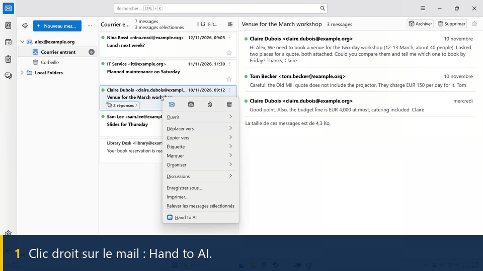

[English](README.md) · **Français**

# Hand to AI pour Thunderbird

**Un clic droit sur un mail dans Thunderbird confie le fil à un agent IA en ligne de commande ; une commande ouvre ensuite dans Thunderbird des réponses pré-remplies que vous envoyez vous-même.**

[](https://drive.google.com/file/d/1dxDcTe66kMsXDhIvdrtuL_6a-FysO6Fo/view)

<details><summary>Version française</summary>

[](https://drive.google.com/file/d/15RIGbanWkeWplC_GqBkeE4C5NKbEv9G2/view)

</details>

*Étapes Thunderbird filmées en vrai, sur un compte de démonstration aux mails inventés ; Claude Code a été lancé à la main sur une copie du dossier exporté (voir État). [Vidéo complète (0:57)](https://drive.google.com/file/d/15RIGbanWkeWplC_GqBkeE4C5NKbEv9G2/view)*

## Utilisation

- **Hand to AI.** Clic droit sur un mail, consigne facultative, puis *Hand over*.
- **Un dossier par mail.** Tout le fil (`NN-message.txt`), ses pièces jointes et la consigne (`INSTRUCTIONS.md`) vont dans `claude-mail/<date>_<heure>_<sujet>/`, dans le dossier de téléchargement de Thunderbird.
- **Votre agent.** Claude Code par défaut ; tout agent en ligne de commande via `config.json`.
- **Pont de réponse.** `cli/tb_reply.py`, lancé par vous ou par votre agent quand votre consigne le mentionne, ouvre une fenêtre Répondre, Répondre à tous ou Transférer dans le fil, ou un nouveau message, texte et pièces jointes remplis. Rien n'est envoyé.

## Architecture


<details><summary>Diagramme en français</summary>


</details>

## Installation

Thunderbird 115 ou plus, Python 3.8 ou plus, la commande de votre agent dans le PATH (par défaut `claude`).

```
git clone https://github.com/anthohunt/thunderbird-confier-a-claude && cd thunderbird-confier-a-claude
python3 install.py           # enregistre les deux hôtes natifs, construit extension/hand-to-ai.xpi
python3 tests/test_hosts.py  # facultatif, Linux/macOS : trois lignes OK
```

Dans Thunderbird : ☰ → Modules complémentaires et thèmes → ⚙ → *Déboguer des modules* → *Charger un module complémentaire temporaire…* → `extension/manifest.json` (jusqu'au prochain redémarrage), ou ⚙ → *Installer un module depuis un fichier…* → `extension/hand-to-ai.xpi` (non signé : mettre `xpinstall.signatures.required` à `false` dans l'éditeur de configuration, comme pour la démonstration, ou le signer comme module non listé).

<details>
<summary>Pont de réponse</summary>

```
python3 cli/tb_reply.py --ping
python3 cli/tb_reply.py --mode replyAll --subject "Quarterly report" --body-file body.html --attach report.pdf
python3 cli/tb_reply.py --mode reply --author alice --subject "Quarterly report" --body-file body.html
python3 cli/tb_reply.py --mode forward --subject "Quarterly report" --to bob@example.org --body-file body.html
python3 cli/tb_reply.py --mode new --to a@example.org --subject "Invoices" --body-file body.html --attach inv1.pdf inv2.pdf
```

`--subject` cherche le mail auquel répondre (le plus récent ; ajouter `--author` pour être sûr ; avec `new`, c'est le sujet lui-même), `--new-subject` le réécrit, `--body-file` est un fragment HTML placé au-dessus de la citation. La réponse est une ligne JSON : le mail trouvé, le sujet posé, les pièces jointes ajoutées. Thunderbird doit être ouvert.
</details>

<details>
<summary>Réglages</summary>

`~/.config/thunderbird-confier-a-claude/config.json` (Windows : `%APPDATA%\thunderbird-confier-a-claude\config.json`), ou le fichier nommé par `TB_CONFIRMER_CONFIG`. Toutes les clés sont facultatives ; voir `config.example.json`.

| Clé | Par défaut | Rôle |
|---|---|---|
| `command` | `["claude"]` | Agent lancé dans le dossier du mail (programme et arguments). |
| `prompt_as_argument` | `true` | Ajoute la consigne en dernier argument ; elle est toujours aussi dans `INSTRUCTIONS.md`. |
| `terminal` | auto | Préfixe du terminal, par exemple `["gnome-terminal", "--"]`. |
| `prompt_file` | `host/prompt.md` | Modèle de consigne (`{{SUBJECT}} {{FROM}} {{DATE}} {{COUNT}} {{THREAD}} {{FOLDER}} {{INSTRUCTION}}`). |
| `queue_dir` | `<dossier de config>/queue` | Où la ligne de commande et l'hôte du pont échangent les commandes. Qui peut y écrire peut ouvrir des fenêtres de rédaction. |
</details>

## État

- **Vérifié le 17/11/2026** sous Windows 11 avec Thunderbird 159 : export au clic droit, fenêtre de consigne et pont de réponse (Répondre à tous, copie gardée, pièce jointe ajoutée) fonctionnent.
- **Défaut connu sous Windows.** Lancé depuis Thunderbird, le terminal de l'agent n'apparaît pas (Thunderbird arrête ce que lance son hôte natif) ; le dossier et `INSTRUCTIONS.md` sont bien écrits, et le même lanceur marche quand on le lance à la main.
- **Linux et macOS** suivent la documentation de Mozilla ; les tests simulés (`tests/test_hosts.py`) passent sous Linux. Pas essayés avec un vrai Thunderbird.
- **Fil** reconstitué par le sujet (Thunderbird n'a pas d'API de fil) : les mails de même sujet, dans tout dossier, sont inclus ; coupé à 50 messages. Les pièces jointes de type `text/*` sont ignorées.
- **Confidentialité.** Un fil confié est lu par votre agent et son fournisseur.
- **Licence.** Code Apache 2.0, textes CC BY 4.0.

---

**Anthony Hunt** · [ingevision.cloud](https://ingevision.cloud/?lang=fr&p=thunderbird-agent) · [LinkedIn](https://www.linkedin.com/in/anthony-hunt-3948a9196) · [GitHub](https://github.com/anthohunt)
