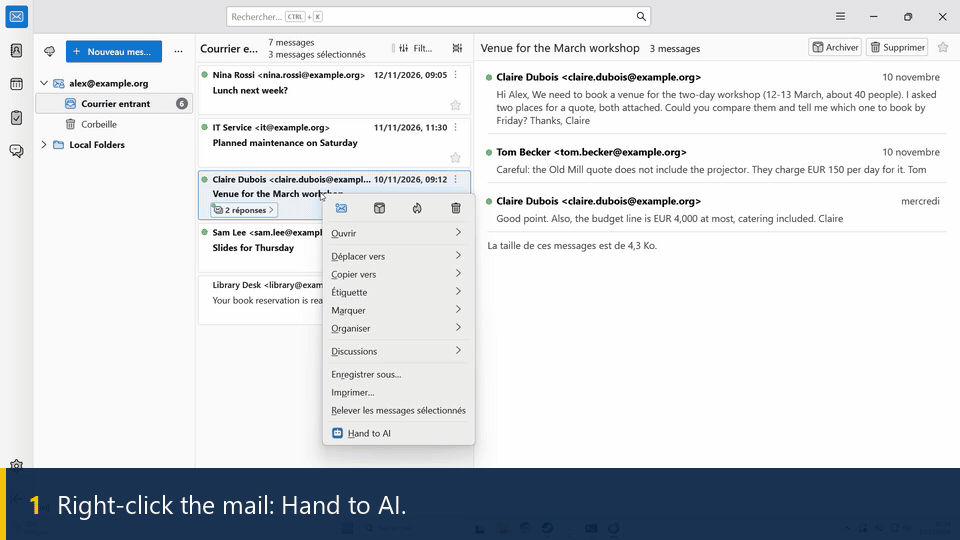

**English** · [Français](README.fr.md)

# Hand to AI for Thunderbird

**Right-click a mail in Thunderbird to hand its thread to a command-line AI agent; a command then opens pre-filled replies in Thunderbird that you send yourself.**

[](https://drive.google.com/file/d/1dxDcTe66kMsXDhIvdrtuL_6a-FysO6Fo/view)

*Thunderbird steps filmed live on a demo account with made-up mails (interface in French); Claude Code was run by hand on a copy of the exported folder (see Status). [Full video (0:57)](https://drive.google.com/file/d/1dxDcTe66kMsXDhIvdrtuL_6a-FysO6Fo/view)*

## Using it

- **Hand to AI.** Right-click a mail, type an optional instruction, press *Hand over*.
- **One folder per mail.** The whole thread (`NN-message.txt`), its attachments and the prompt (`INSTRUCTIONS.md`) go to `claude-mail/<date>_<time>_<subject>/` in Thunderbird's download folder.
- **Your agent.** Claude Code by default; any command-line agent through `config.json`.
- **Reply bridge.** `cli/tb_reply.py`, run by you or by your agent when your instruction mentions it, opens a Reply, Reply all or Forward window inside the thread, or a New one, body and attachments filled in. Nothing is sent.

## Architecture


<details><summary>French version</summary>


</details>

## Install

Thunderbird 115 or newer, Python 3.8 or newer, your agent's command on the PATH (default `claude`).

```
git clone https://github.com/anthohunt/thunderbird-confier-a-claude && cd thunderbird-confier-a-claude
python3 install.py           # registers the two native hosts, builds extension/hand-to-ai.xpi
python3 tests/test_hosts.py  # optional, Linux/macOS: three OK lines
```

In Thunderbird: ☰ → Add-ons and Themes → ⚙ → *Debug Add-ons* → *Load Temporary Add-on…* → `extension/manifest.json` (until the next restart), or ⚙ → *Install Add-on From File…* → `extension/hand-to-ai.xpi` (unsigned: set `xpinstall.signatures.required` to `false` in the Config Editor, as for the demo, or sign it as an unlisted add-on).

<details>
<summary>Reply bridge</summary>

```
python3 cli/tb_reply.py --ping
python3 cli/tb_reply.py --mode replyAll --subject "Quarterly report" --body-file body.html --attach report.pdf
python3 cli/tb_reply.py --mode reply --author alice --subject "Quarterly report" --body-file body.html
python3 cli/tb_reply.py --mode forward --subject "Quarterly report" --to bob@example.org --body-file body.html
python3 cli/tb_reply.py --mode new --to a@example.org --subject "Invoices" --body-file body.html --attach inv1.pdf inv2.pdf
```

`--subject` searches the mail to answer (the most recent match; add `--author` to be sure; with `new` it is the subject itself), `--new-subject` rewrites it, `--body-file` is an HTML fragment placed above the quote. The answer is one JSON line: the matched mail, the subject set, the attachments added. Thunderbird must be running.
</details>

<details>
<summary>Settings</summary>

`~/.config/thunderbird-confier-a-claude/config.json` (Windows: `%APPDATA%\thunderbird-confier-a-claude\config.json`), or the file named by `TB_CONFIRMER_CONFIG`. Every key is optional; see `config.example.json`.

| Key | Default | Meaning |
|---|---|---|
| `command` | `["claude"]` | Agent started in the mail folder (program and arguments). |
| `prompt_as_argument` | `true` | Adds the prompt as the last argument; it is always in `INSTRUCTIONS.md` too. |
| `terminal` | auto | Terminal prefix, e.g. `["gnome-terminal", "--"]`. |
| `prompt_file` | `host/prompt.md` | Prompt template (`{{SUBJECT}} {{FROM}} {{DATE}} {{COUNT}} {{THREAD}} {{FOLDER}} {{INSTRUCTION}}`). |
| `queue_dir` | `<config dir>/queue` | Where the CLI and the bridge host exchange commands. Anyone who can write there can open compose windows. |
</details>

## Status

- **Checked on 17/11/2026** on Windows 11 with Thunderbird 159: right-click export, instruction window and reply bridge (Reply all, Cc kept, attachment added) work.
- **Known issue on Windows.** Started from Thunderbird, the agent's terminal does not appear (Thunderbird ends what its native host starts); the folder and `INSTRUCTIONS.md` are written, and the same launcher works when started by hand.
- **Linux and macOS** follow the Mozilla documentation; the simulated tests (`tests/test_hosts.py`) pass on Linux. Not tried with a real Thunderbird.
- **Thread** rebuilt by subject (Thunderbird has no thread API): mails with the same subject in any folder are included; cut at 50 messages. Attachments of type `text/*` are skipped.
- **Privacy.** A handed-over thread is read by your agent and its provider.
- **License.** Code Apache 2.0, text CC BY 4.0.

---

**Anthony Hunt** · [ingevision.cloud](https://ingevision.cloud/?lang=en&p=thunderbird-agent) · [LinkedIn](https://www.linkedin.com/in/anthony-hunt-3948a9196) · [GitHub](https://github.com/anthohunt)
